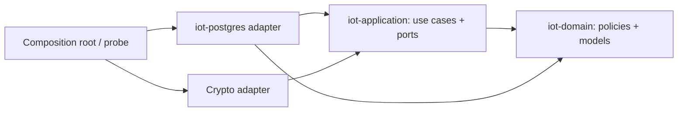

# Database runtime theo Clean Architecture

Dependency compile-time:

Core không import SQLx/Tokio/HTTP/Argon2. Application gọi unit-of-work port;
adapter giữ transaction SQLx riêng, nên authorize/required audit/receipt/mutation
vẫn cùng commit. Không giữ DbRow hoặc infrastructure error trong domain DTO.

| Invariant | Policy/use case | PostgreSQL defense | Evidence |
| --- | --- | --- | --- |
| Email/password boundary | domain/input | natural UK/length CHECK | Rust input tests |
| Failure5/15min; request6 limited | LoginWindow + login | shared bucket lock, coherence CHECK |6 request/2 pool |
| Không phát session trước audit+commit | login | transaction + actor/session FK | application fault tests, PG happy path |
| Current session/context/limited | SessionSnapshot | immutable admission, revoke trigger | stale context/limited/revoked checks |
| Password change revoke đủ capability | change_password | User fence; native revoke trigger | RED→GREEN2 session+ticket+binding+outbox |
| Preference chỉ chính chủ/CAS không đổi instant | get/update_preferences + domain revision | User→preference lock, exact timezone catalog, default materialize cùng audit | missing read không INSERT, two-pool CAS, limited/context deny, audit fault rollback và WAIT due_at giữ nguyên |
| Workspace+Admin+grant/quota5 | create_workspace | deferred FK/admin check, creator fence | concurrent quota2 pool |
| Same key/body không duplicate | IdempotencyKey + create_workspace | global receipt PK + transaction | replay/body/current-suspension checks |
| Scoped audit Admin-only | list_audit | bound workspace/cutoff/keyset query | USER/foreign/global/cutoff negatives |
| Audit resource/reason/diff không secret | AuditDetail hữu hạn + required audit port | actor/scope manifest guard, metadata bind vào jsonb |20 variants, anonymous attribution, allowlist value/type scan |
| Audit lỗi rollback hoặc deny đúng boundary | mutation/failed-auth orchestration | audit INSERT permission denial trên role tạm; fixed counters ngoài DB | member/reset/workspace rollback; failed auth giữ limiter và có metric |
| Audit theo ingestion time | created_at cursor + current audit admission | server default + column INSERT allowlist, index tenant/created/id | late/future event-time, Admin inactive workspace, override denied |
| Purge audit idempotent/atomic | AuditRetentionService + ports riêng | immutable run/batch, advisory lock và SKIP LOCKED | hai worker pool, cutoff/replay, INSERT result lỗi rollback DELETE |
| Ticket30s một winner | issue/consume realtime | native consume CAS/current versions |2 pool winner + S1/S2 revoke |
| Outbox epoch/clock sau khóa | CloseOutboxService + typed close intent | SKIP LOCKED claim; native0017 complete khóa identity trước clock/CAS; retry adapter cùng fence | Engine regression chờ khóa qua expiry; không coi completion ledger là socket đã đóng |
| Template draft/publish CAS, version immutable | TemplateService riêng + validator/canonical bytes + TemplateDigest port hẹp | User→Workspace→Template lock, normalized children, marker0013 và required audit cùng commit | two-pool publish một winner; v2 không đổi v1/pin; digest tái dựng từ version rows; audit fault rollback |
| Template direct read current Admin-only | TemplateService current authorization | scope bound trong root/version/child queries | USER không đọc trực tiếp version bằng UUID; DeviceService resolve current assignment/pin trước load schema |
| Registry device atomic và serial global | DeviceService + ApprovedDeviceModels + domain validator | sorted Users→Workspace→Template, global serial UK, device/runtime/actuator/audit cùng transaction | hai pool cùng/khác tenant một winner; UNKNOWN, hardware NULL, sensor-only0 actuator và audit fault rollback |
| Schema theo current Admin/assigned owner | DeviceService schema và domain DevicePin | lookup(W,D) trước immutable version read; digest tái dựng từ pin | USER unassigned/foreign/missing không leak; member suspend chặn ngay, v2 không đổi v1 |
| Invitation24h/email/current issuer/fence | create/accept_invitation | pending unique, scoped/global receipt keys, immutable snapshot, User→Workspace locks |2 pool consume, expiry, issuer/admission negatives |
| Invitation metadata/revoke theo current Admin/CAS | list/get/revoke_invitation + domain terminal policy | engine revision, terminal XOR/time shape và scoped keyset index | revoke/accept race, no-op1 audit, expired metadata không cron, audit fault rollback |
| Rejoin không revive grant/receipt cũ | accept_invitation | current-grant deferred FK + immutable historical grants | SUSPENDED denial, REMOVED grant1→2, old receipt denied |
| Email mới là account tạm, existing chỉ invitation | create_member + typed request/outcome | global email advisory fence, natural unique, scoped receipt + member/grant deferred FK | hai Admin/hai tenant race, one-time/replay, required audit rollback |
| Không hash cho request thiếu quyền và không tin preflight để ghi | create_member preflight đóng trước hash + final authorize | User/Workspace fences và clock sau lock |0 hash invalid/limited/USER/foreign, barrier suspend sau preflight |
| Reset chỉ account tạm đủ điều kiện | reset_temporary_password | sorted Users → Workspace/member, revision CAS, indexed admission ledger | protected/global/multi-workspace, two-pool CAS,5/15min và limited login |
| Member CAS và last capable Admin | update_member | Workspace fence + deferred native guard | two-pool self-demote một winner, stale Admin bị chặn |
| Suspend/remove chỉ ảnh hưởng tenant đích | update_member + scoped effects | workspace-bound ticket/key/job/command/outbox SQL | tenant B/session giữ nguyên; suspend giữ key, remove revoke grant/key |
| Công việc đã dispatch/UNKNOWN giữ để đối soát | scoped effects adapter | kiểm độc lập action/job/command intent; NEEDS_ATTENTION | cả hai chiều state lag và TIMED_OUT/UNKNOWN/unresolved actuator |

Đường đọc trả admission/cursor nội bộ không tự là credential hoặc cursor ký cho
HTTP. Route/WS handler tương lai phải giữ current authorization, exact-origin,
CSRF, auth-context và transport contracts; chưa có listener production trong slice này.

SQL migration source/ledger vẫn ở `migrations/platform/`; psql runner không bị
thay bằng SQLx auto-migrate. `schema.sql`/`platform.sql` giữ fingerprint đã kiểm.
Pool probe nhận credential qua stdin launcher, không từ URL/argv/secret file.
Không dùng role DBeaver reader hoặc schema owner chạy application use case.

[ADR-003](../docs/adr/adr-003-clean-architecture-database-runtime.md),
[task/evidence](../docs/plan/database/runtime-implementation.md).

[Audit coverage](../docs/plan/database/audit-coverage.md) liệt kê mapping hiện hành.
Composition có thể đọc `PgIdentityStore::failed_audit_counts()` để export hai counter
audit degraded không PII; chưa có production metrics endpoint hoặc alert trong slice này.

Retention không gắn vào IdentityService hoặc user route. Domain giữ policy720 giờ
và batch1…1000; application điều phối run/batch/commit qua port; PG giữ lock/query.
Hai bảng metadata chuẩn hóa run→cutoff và batch→run/limit/count/completed-at, không
lặp started-at suy ra. Audit batch chỉ xóa audit; session/ticket/binding giữ nguyên.
Probe worker dùng pool SET ROLE riêng, app không inherit DELETE; quyền khóa UPDATE(ID)
được immutable trigger bảo vệ. Production composition cần credential worker độc lập
và scheduler, không dùng shared probe login làm bằng chứng đã cách ly production.
